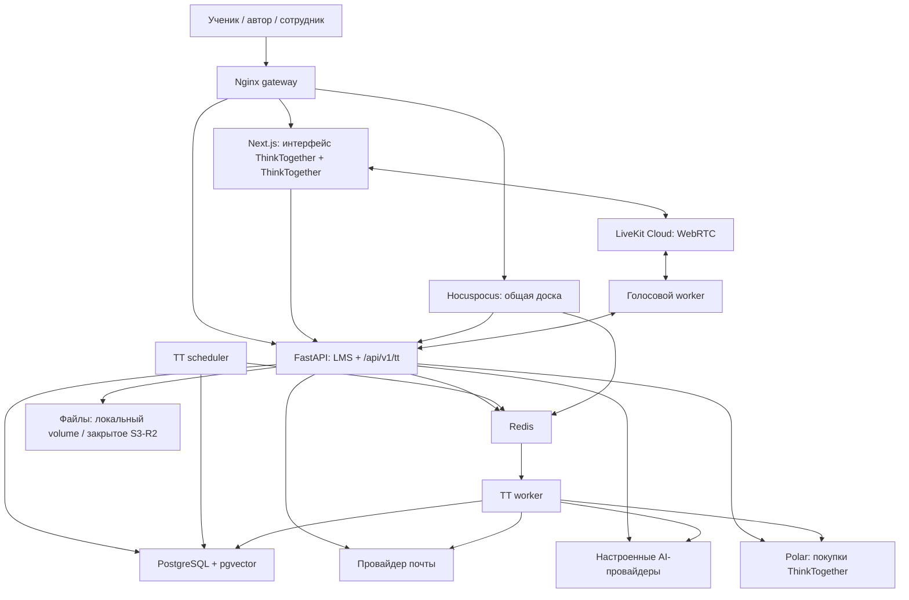
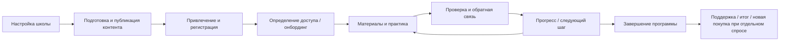
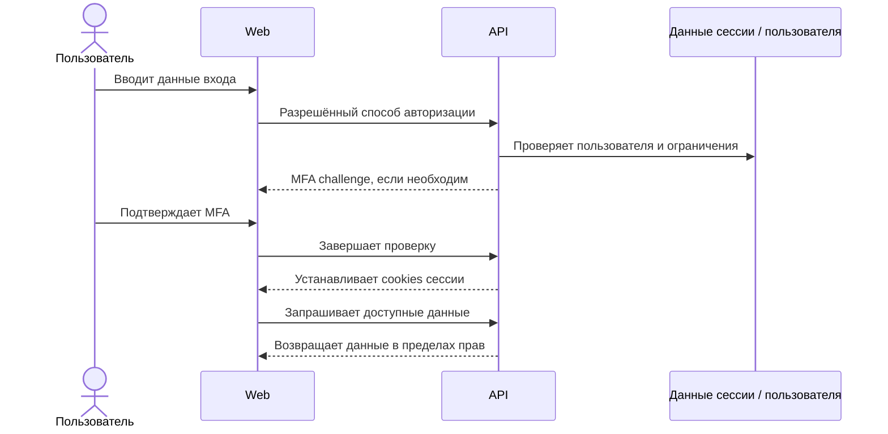
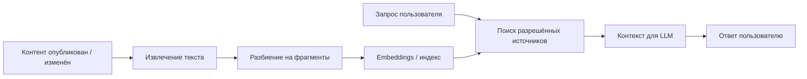
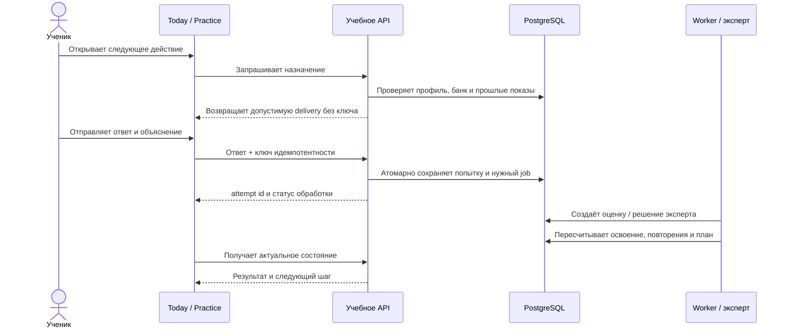
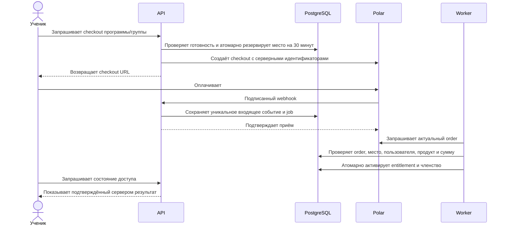
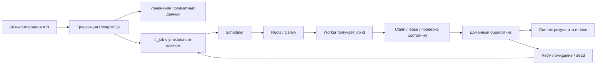

# ThinkTogether + ThinkTogether: полный цикл приложения и бизнес-процессы

**Дата среза: 15 ноября 2026 года, Asia/Qyzylorda.**

Это карта всей нашей платформы: исходного ThinkTogether, добавленного ThinkTogether, пользователей, данных, процессов, сервисов и выпуска приложения. Документ описывает текущий проект, а не только идею будущего продукта.

Обозначения:

- **Есть в коде** — найдена соответствующая реализация. Это не означает, что настроен внешний провайдер или проверен каждый сценарий в production.
- **Проверено локально** — есть зафиксированный результат проверки локальной установки.
- **Требует подключения** — нужен аккаунт, ключ, лицензия, настройки или проверка внешнего сервиса.
- **Операционный процесс** — действие сотрудника или правило бизнеса; наличие API не заменяет выполнение этого действия человеком.
- **EE/SaaS** — функция исходного ThinkTogether, доступность которой зависит от Enterprise/SaaS-режима. Присутствие страницы, типа данных или адаптера в OSS не делает такую функцию работающей.

## Содержание

1. [Что представляет собой всё приложение](#1-что-представляет-собой-всё-приложение)
2. [Что работает сейчас](#2-что-работает-сейчас)
3. [Что означает main и откуда запускается приложение](#3-что-означает-main-и-откуда-запускается-приложение)
4. [Роли, организации и права](#4-роли-организации-и-права)
5. [Общая архитектура и сервисы](#5-общая-архитектура-и-сервисы)
6. [Общий бизнес-цикл платформы](#6-общий-бизнес-цикл-платформы)
7. [Регистрация, вход и присоединение к организации](#7-регистрация-вход-и-присоединение-к-организации)
8. [Настройка школы и навигация](#8-настройка-школы-и-навигация)
9. [Создание, импорт и публикация курса ThinkTogether](#9-создание-импорт-и-публикация-курса-thinktogether)
10. [Обучение, Trail, Paths и сертификаты](#10-обучение-trail-paths-и-сертификаты)
11. [Задания ThinkTogether и оценивание](#11-задания-learnhouse-и-оценивание)
12. [Файлы, библиотека, видео и аудио](#12-файлы-библиотека-видео-и-аудио)
13. [Сообщества, обсуждения и сообщения](#13-сообщества-обсуждения-и-сообщения)
14. [Доски, playgrounds и исполнение кода](#14-доски-playgrounds-и-исполнение-кода)
15. [Поиск и AI в ThinkTogether](#15-поиск-и-ai-в-thinktogether)
16. [Календарь, письма и возвращение пользователя](#16-календарь-письма-и-возвращение-пользователя)
17. [Все коммерческие контуры](#17-все-коммерческие-контуры)
18. [Программа и контент ThinkTogether](#18-программа-и-контент-thinktogether)
19. [Онбординг, диагностика и личный профиль ThinkTogether](#19-онбординг-диагностика-и-личный-профиль-thinktogether)
20. [Индивидуальный учебный цикл](#20-индивидуальный-учебный-цикл)
21. [Как обновляются план и освоение](#21-как-обновляются-план-и-освоение)
22. [Группы, расписание и полный цикл занятия](#22-группы-расписание-и-полный-цикл-занятия)
23. [Видео и голосовой AI](#23-видео-и-голосовой-ai)
24. [Покупка через Polar, возврат и завершение доступа](#24-покупка-через-polar-возврат-и-завершение-доступа)
25. [Экспертная проверка и поддержка](#25-экспертная-проверка-и-поддержка)
26. [Интеграции, API, webhooks и MCP](#26-интеграции-api-webhooks-и-mcp)
27. [Технический путь запроса и запуска](#27-технический-путь-запроса-и-запуска)
28. [Фоновые процессы и надёжность](#28-фоновые-процессы-и-надёжность)
29. [Данные и границы безопасности](#29-данные-и-границы-безопасности)
30. [Карта экранов и API](#30-карта-экранов-и-api)
31. [Разработка, сборка, релиз и восстановление](#31-разработка-сборка-релиз-и-восстановление)
32. [Ежедневная работа команды и бизнес-показатели](#32-ежедневная-работа-команды-и-бизнес-показатели)
33. [Нештатные ситуации](#33-нештатные-ситуации)
34. [Что ещё необходимо для платного запуска](#34-что-ещё-необходимо-для-платного-запуска)
35. [Полный пример пути одного клиента](#35-полный-пример-пути-одного-клиента)
36. [Где искать реализацию](#36-где-искать-реализацию)

## 1. Что представляет собой всё приложение

**ThinkTogether — базовая учебная платформа. ThinkTogether — наш продуктовый учебный контур внутри её проекта.** Они используют общие аккаунты, организацию, материалы и инфраструктуру, но решают разные задачи.

| Слой | Для чего нужен | Основной результат |
|---|---|---|
| ThinkTogether LMS | Создать школу, материалы, курсы, задания и организовать их прохождение | Пользователь получает доступ к учебному контенту и историю прохождения |
| ThinkTogether | Подготовка к PMP с диагностикой, личным маршрутом и постоянной группой | Отдельно проверяется самостоятельное применение навыков и их сохранность |
| Enterprise/SaaS ThinkTogether | Дополнительные функции и коммерческая инфраструктура исходной платформы | Доступны только при соответствующем режиме и реализации EE |
| Эксплуатация | Сборка, хранение, очереди, безопасность, поддержка и восстановление | Продукт сохраняет данные и корректно переживает ошибки |
| Работа команды | Контент, психометрика, реальные группы и коммерческое предложение | Появляется продукт, который можно обоснованно продавать |

Основные различия, которые влияют на бизнес:

- `Course` ThinkTogether — набор глав и учебных активностей. `tt_program` — версия программы подготовки с навыками, диагностикой и банком заданий.
- `UserGroup` ThinkTogether — механизм назначения доступа. `tt_cohort` — постоянная учебная группа с расписанием и ограничением вместимости.
- `Trail` — история прохождения. `Path` — последовательность курсов. Персональный план ThinkTogether — отдельный механизм назначения действий по учебным данным.
- Завершение урока показывает факт прохождения. Оно само по себе не подтверждает самостоятельный перенос навыка ThinkTogether.
- Обычное сообщение сообщества, ответ на общей доске и речь на занятии не являются личной проверочной попыткой.
- Наличие интерфейса оплаты ThinkTogether не означает, что работает продажа ThinkTogether. Наш коммерческий доступ обслуживает отдельный контур Polar.

## 2. Что работает сейчас

### 2.1. Проверенный текущий режим

При составлении документа публичный `/api/v1/instance/info` на 8096 вернул:

| Параметр | Значение |
|---|---|
| Режим | `oss` |
| Размещение организаций | `single` |
| Организация по умолчанию | `default` |
| Multi-org | `false` |
| Health ThinkTogether | HTTP 200 |
| Health контрольного ThinkTogether | HTTP 200 |

Адрес приложения: [ThinkTogether / Today](http://localhost:8096/thinktogether/today).

Контрольный исходный ThinkTogether: [localhost:8095](http://localhost:8095/).

Эти localhost-адреса относятся к данному компьютеру. Это локальная установка, не опубликованный production-сайт.

### 2.2. Состояние основных частей

| Часть | Состояние |
|---|---|
| Аккаунты и нативный интерфейс ThinkTogether | Используются в проекте |
| Редактор и контент ThinkTogether | Сохранены |
| Today, программа, практика, профиль, группа, прогресс, оплата, Expert | Реализованы в ThinkTogether |
| Навигация | Разделы ThinkTogether находятся в `More → Core`; на мобильном есть прямой `Today` |
| Backend ThinkTogether | Реализован под `/api/v1/tt` |
| Локальные сервисы | Последняя зафиксированная проверка: работают web, API, worker, scheduler, collab, PostgreSQL, Redis, gateway |
| Голосовой процесс | Реализован и тестировался отдельно; локально требует настоящих ключей LiveKit |
| Видео/голос с облачным провайдером | Не подтверждены проведённым реальным облачным занятием |
| Polar | Код checkout, webhook, резервов и возвратов есть; реальные продажи требуют подключения и допуска |
| Полная опубликованная программа PMP | Требует работы и утверждения предметного эксперта |
| Когнитивная диагностика | Движок есть; необходим лицензированный и утверждённый методический пакет |
| Платный запуск | Закрыт до выполнения критериев готовности |

Последние зафиксированные результаты: 200 тестов ThinkTogether API, включая 7 проверок PostgreSQL; 743 web-теста; 40 тестов collab; 151 выбранная регрессионная проверка базового ThinkTogether. В отдельную базу восстановлены 123 public-таблицы с совпадением числа строк и миграции. Это не означает, что протестированы все внешние функции ThinkTogether или production-нагрузка.

Подробности и ограничения: [STATUS.md](thinktogether/STATUS.md), [RUNBOOK.md](thinktogether/RUNBOOK.md).

### 2.3. Что означает доступность функций ThinkTogether

В текущем исходнике `EE_ONLY_FEATURES` включает `sso`, `audit_logs`, `payments`, `analytics_advanced`, `scorm`, `lti`, `live_sessions`, `messaging`.

В OSS эти функции нельзя считать включёнными только потому, что их название встречается в меню, роуте или модели. Публичная реализация содержит точки расширения и проверки режима. Частный EE-код не является частью нашей работающей OSS-установки.

Остальные модули тоже могут требовать включения feature в настройках организации, разрешений, файлового хранилища или внешнего AI-провайдера.

## 3. Что означает main и откуда запускается приложение

### 3.1. Ветки и рабочие каталоги

| Что | Текущее расположение / значение |
|---|---|
| Исходная рабочая копия | `C:/Users/Ferumm/zimran/learnhouse` |
| Ветка исходной копии | `dev` |
| Рабочая копия нашего проекта | `C:/Users/Ferumm/zimran/learnhouse/.worktrees/thinktogether` |
| Активная ветка проекта | `feat/thinktogether` |
| Базовый commit обеих рабочих копий | `88594178` |
| Ветка `main` | Не является текущей рабочей веткой этого проекта |

Одинаковый HEAD не означает одинаковый код: изменения ThinkTogether находятся в рабочем дереве проекта. Название ветки не доказывает, что изменения уже закоммичены, отправлены на GitHub или слиты в основную ветку.

### 3.2. Единственного main для всей платформы нет

Это несколько приложений и процессов:

| Процесс | Точка входа | Что делает при запуске |
|---|---|---|
| Web | `apps/web/server-wrapper.js` | Запускает собранный Next.js-сервер и работу с runtime-конфигурацией |
| API | `apps/api/app.py`, объект `app` | Создаёт FastAPI, middleware, роутеры и lifecycle приложения |
| TT worker | `apps/api/src/services/thinktogether/jobs_worker.py`, `main()` в режиме `worker` | Поднимает Celery-потребитель очереди ThinkTogether |
| TT scheduler | Тот же `main()`, режим `scheduler` | Периодически назначает и отправляет сохранённые задания |
| Collab | `apps/collab/src/index.ts`; в образе `dist/index.js` | Запускает Hocuspocus для общей доски |
| Voice | `apps/voice-agent/thinktogether_voice/worker.py` | Регистрирует LiveKit agent и обработчик комнаты |
| Gateway | Конфигурация Nginx | Направляет HTTP, SSE и WebSocket к нужному сервису |
| Миграции | Alembic / `apps/api/cli.py` | Проверяют и изменяют версию схемы; это отдельная операция выпуска |

Команда текущего API-образа: `uvicorn app:app --host 0.0.0.0 --port 9000`.

`main()` worker выбирает режим процесса. `app:app` означает «объект app из файла app.py». Ветка Git, Python-функция `main()` и главный бизнес-цикл — три разных понятия.

## 4. Роли, организации и права

### 4.1. Бизнес-роли

| Участник | Его задача | Что не следует из роли автоматически |
|---|---|---|
| Гость | Посмотреть разрешённый публичный каталог и описание продукта | Читать закрытые материалы и личные результаты |
| Ученик | Учиться, отправлять собственные работы, участвовать в разрешённых группах | Управлять чужой группой или оценками |
| Автор / преподаватель ThinkTogether | Готовить материалы и задания в пределах выданных прав | Администрировать весь экземпляр платформы |
| Администратор организации | Управлять школой, участниками, ролями и функциями | Автоматически получить лицензию Enterprise |
| Суперадминистратор экземпляра | Обслуживать установку и общие административные функции | Подменять собой подтверждение оплаты или учебного результата |
| TT expert | Утверждать учебный контент и разбирать спорные оценки | Управлять платежами без соответствующего разрешения |
| TT operator | Набирать группы, вести расписание и поддержку | Видеть психометрические данные без отдельного допуска |
| TT psychometric | Работать с когнитивными инструментами и результатами | Ранжировать людей для доступа к обучению по интеллекту |
| TT billing | Работать с коммерческим состоянием и финансовыми обращениями | Самостоятельно менять освоение навыка |
| AI-фасилитатор | Помогать обсуждению через ограниченные команды | Изменять оценки, деньги и членство напрямую |

### 4.2. Как устроены уровни доступа

```text
Пользователь
  → членство в организации
  → роль и разрешённое действие
  → конкретный ресурс и его владелец/автор
  → видимость / публикация / назначенная user group
  → коммерческий доступ, если ресурс связан с ThinkTogether
  → членство и фаза комнаты для совместного занятия
```

Проверки выполняются на сервере. Отсутствие ссылки в меню не является защитой данных.

В ThinkTogether контекст организации определяется сервером. Пользователь не может получить чужие данные, подставив другой `user_id` или `org_id` в запрос.

Текущие дополнительные разрешения ThinkTogether: `content`, `groups`, `support`, `psychometrics`, `billing`. Роль `admin` проходит все эти проверки; остальные роли имеют ограниченные наборы.

## 5. Общая архитектура и сервисы



| Сервис | Ответственность | Где окончательная истина |
|---|---|---|
| `web` | Страницы ученика, редактор, dashboard, экспертное рабочее место | Не в локальном состоянии браузера |
| `api` | Авторизация, бизнес-правила, данные, публикация и команды | PostgreSQL и разрешённое файловое хранилище |
| `worker` | Проверка рассуждений, обработка платежных событий, письма и отложенные действия TT | `tt_job` и доменные таблицы |
| `scheduler` | Поиск наступивших событий и восстановление обработки | Задания и lease в PostgreSQL |
| `collab` | Синхронизация Yjs; права доски запрашивает у API | Сохранённый документ; Redis используется как кеш |
| `voice-agent` | Потоки распознавания участников и очередь речи агента | Авторизованный контекст API и сохранённые события |
| `db` | Пользователи, контент, попытки, деньги, членства и задания | Основное постоянное хранилище |
| `redis` | Кеш, транспорт событий, брокер Celery, отдельные очереди LMS | Не единственное хранилище истории ThinkTogether |
| `gateway` | Единый HTTP-вход и маршрутизация | Не принимает учебных и коммерческих решений |

В production запланированы Neon для PostgreSQL, закрытый R2 для файлов, Resend для почты, LiveKit Cloud и Polar. Локально PostgreSQL и Redis работают в собственном Compose-проекте; файлы могут находиться в локальном volume. Наличие production-шаблона не означает создание этих облачных ресурсов.

## 6. Общий бизнес-цикл платформы



Для обычного ThinkTogether петля строится вокруг курсов, заданий и прохождения. Для ThinkTogether в неё добавляются диагностика, реальные группы, независимые задачи после обсуждения и отсроченная проверка.

| Процесс | Кто отвечает | Что запускает | Завершённый результат |
|---|---|---|---|
| Настройка организации | Администратор | Развёртывание или создание школы | Работают домен/адрес, правила входа и роли |
| Подготовка курса | Автор | Учебная задача | Опубликован доступный курс |
| Приём ученика | Организация | Регистрация / приглашение | Подтверждённое членство и разрешённый доступ |
| Обычное обучение | Ученик + преподаватель | Запись на курс/Path | Прохождение, работы и оценки сохранены |
| Подготовка TT-продукта | Эксперт + психометрик + оператор | Решение запустить программу | Утверждены содержание, диагностика и реальные группы |
| Продажа TT | Коммерческий оператор + Polar | Совместимое место и готовый ученик | Подтверждённая покупка, доступ и членство |
| Учебный цикл TT | Ученик + группа + эксперт | Личный план / занятие | Появились проверяемые самостоятельные результаты |
| Поддержка и спор | Сотрудник с разрешением | Обращение / спорная оценка | Ответ или новая оценка с историей решения |
| Эксплуатация | Технический оператор | Релиз, сбой, проверка восстановления | Работоспособная версия с сохранёнными данными |

## 7. Регистрация, вход и присоединение к организации

### 7.1. Регистрация

1. Посетитель открывает школу или страницу входа.
2. Интерфейс определяет организацию и её разрешённые способы авторизации.
3. Человек регистрируется или принимает приглашение.
4. Сервер проверяет данные, правила присоединения и ограничения организации.
5. Создаётся/находится аккаунт, оформляется членство и назначается допустимая роль.
6. Выполняется подтверждение email там, где его требует сценарий.
7. Пользователь попадает в интерфейс организации; в ThinkTogether — далее в обязательный онбординг.

Регистрация аккаунта, членство в организации, запись на курс, вступление в TT-группу и покупка доступа — отдельные операции.

### 7.2. Вход и сессия



В исходнике есть парольный вход, Google, magic-link и управление MFA; конкретная доступность зависит от конфигурации. SSO — отдельная EE-функция.

Короткая сессия доступа обновляется через refresh-механизм с ротацией и проверкой отзыва. Выход, смена пароля и отзыв сессии должны прекращать дальнейшее использование соответствующих credentials. Временная недоступность refresh не должна считаться доказательством, что пользователь вышел.

### 7.3. Бизнес-исключения

- Email не подтверждён: нельзя выдавать права, для которых требуется подтверждение.
- Приглашение недействительно: не создавать членство только по факту перехода по URL.
- Организация закрыта для самостоятельного вступления: нужен разрешённый сценарий приглашения.
- Требуется MFA: вход в защищённый контур не завершён до подтверждения.
- Учётная запись есть, но доступ к ресурсу отсутствует: пользователь не получает ресурс автоматически.

Основные данные: `User`, `UserOrganization`, `Role`, MFA-данные, сессии/отзыв и одноразовые токены ссылок.

## 8. Настройка школы и навигация

Администратор задаёт название, оформление, правила регистрации, разрешённые функции, участников, роли и порядок меню. Навигация ThinkTogether читает конфигурацию организации и `resolved_features`.

Доступность пункта определяется одновременно конфигурацией, режимом установки и правами. Меню не должно обещать работу функции, которую сервер блокирует.

Основные пространства:

| Пространство | Для чего |
|---|---|
| Ученический интерфейс | Каталоги, прохождение, прогресс, сообщества, личные настройки |
| Dashboard организации (`/dash`) | Курсы, авторинг, пользователи, настройки и доступные инструменты школы |
| Редактор (`/editor/...`) | Редактирование конкретной учебной активности или playground |
| Администрирование экземпляра (`/admin`) | Управление установкой при соответствующем доступе |
| Hub (`/organizations`, `/billing` и другие страницы) | Общие аккаунтные/организационные сценарии; часть относится к SaaS |
| ThinkTogether Core | Today, My program, Practice, My group, My progress, My profile, My access |
| ThinkTogether Expert | Контент, оценки, группы, поддержка и коммерческий контроль по разрешениям |

В нашей версии нативные разделы ThinkTogether сохранены. Подразделы ThinkTogether собраны в `More → Core`; на телефоне дополнительно есть прямой активный таб `Today`. Плавающая плашка Made with ThinkTogether скрывается в TT-режиме; исходники AGPL остаются доступны отдельно.

## 9. Создание, импорт и публикация курса ThinkTogether

### 9.1. Структура контента

```text
Organization
  └─ Course
      └─ упорядоченные Chapter
          └─ упорядоченные Activity
              ├─ страница / Markdown / embed / custom
              ├─ видео / документ
              ├─ Assignment и его задачи
              └─ другие типы, доступные в режиме установки
```

Связи порядка представлены отдельными сущностями `CourseChapter` и `ChapterActivity`. Наличие курса не означает, что все его активности опубликованы или доступны ученику.

### 9.2. Работа автора

1. Автор создаёт курс, описание, обложку и настройки видимости.
2. Добавляет главы и активности.
3. В редакторе формирует содержимое, блоки, ссылки, упражнения и необходимые файлы.
4. Настраивает задания и критерии оценивания, если они нужны.
5. Определяет авторов, user groups, блокировки и правила поэтапного открытия.
6. Проверяет материал в роли ученика.
7. Публикует курс и нужные активности.
8. После изменений учитывает версии активности и обновление индекса поиска/AI.

ThinkTogether содержит шаблоны редактора, переменные и версии активностей. Это помогает повторно использовать структуру и управлять содержимым, но не является процедурой экспертного утверждения PMP-банка.

### 9.3. Доступ к активности

В модели есть `public`, `authenticated`, `restricted`. Они задают разные требования к читателю. Дополнительно учитываются публикация, организация, доступ к родительскому ресурсу, ограничения user groups, drip и коммерческие проверки, когда применимы.

Для материала, связанного с платной программой ThinkTogether, обычный URL курса или файла не должен обходить TT entitlement.

### 9.4. Импорт существующих материалов

В исходнике есть миграция файлов в структуру курса и подсистема LMS import. В дереве проекта есть преобразователи и проверки форматов Moodle, Canvas, Common Cartridge, Blackboard, Brightspace и Open edX.

Общий процесс:

```text
Исходный архив / файлы
  → проверка формата и безопасных путей
  → разбор структуры
  → преобразование в внутреннее представление
  → создание курса / глав / активностей / файлов
  → отчёт о поддержанном и потерянном содержимом
  → проверка автором
  → публикация
```

Поддержка импортера не гарантирует точное воспроизведение каждого внешнего курса. SCORM player и LTI имеют отдельные Enterprise-ограничения; импорт структуры не равен доступности интерактивного SCORM-runtime.

**Бизнес-владелец:** автор/преподаватель. **Готовый результат:** проверенный опубликованный курс с нужными правами, а не только успешно загруженный архив.

## 10. Обучение, Trail, Paths и сертификаты

### 10.1. Обычный путь ученика ThinkTogether

1. Ученик находит доступный курс.
2. Открывает описание и начинает разрешённое прохождение.
3. Читает материалы, смотрит видео, выполняет задания.
4. Сервер записывает шаги и состояние прохождения.
5. Преподаватель оценивает работы, если это требуется.
6. Проверяются условия завершения и выдачи сертификата.

### 10.2. Trail

`Trail`, `TrailRun`, `TrailStep` хранят историю прохождения. У `TrailRun` есть состояния `STATUS_IN_PROGRESS`, `STATUS_COMPLETED`, `STATUS_PAUSED`, `STATUS_CANCELLED`.

Шаг связывает человека, курс, активность, факт завершения, оценку и подтверждение преподавателем. Ограничения уникальности защищают от дублирования одних и тех же записей при повторных запросах.

### 10.3. Paths

Path — упорядоченный набор курсов с обязательными и факультативными элементами. Он имеет запись участника и собственный сертификат.

Настройки включают публикацию, публичность, последовательное продвижение, требуемое число факультативных курсов и сертификат.

**Особенность текущей модели:** последовательность ограничивает движение в представлении Path. Она сама по себе не запрещает открыть отдельно доступный курс по его собственному адресу.

### 10.4. Сертификаты

Платформа проверяет предусмотренные условия завершения. Сертификат Path создаётся с защитой от дублирования; отзыв сохраняет запись, чтобы повторная проверка не перевыпустила её незаметно.

Сертификат прохождения школы не равен официальному PMP. Автоматического обещания PMI contact hours или официального статуса сертификации в нашем продукте нет.

## 11. Задания ThinkTogether и оценивание

### 11.1. Типы задач

В исходной модели есть загрузка файла, quiz, form, code, short answer, number answer и дополнительные custom/other-типы. Автор выбирает формат оценки: буквенный, числовой, процентный, pass/fail или GPA.

### 11.2. Процесс

```text
Автор публикует задание
  → ученик получает разрешённые условия
  → сохраняет ответы / прикладывает файлы
  → отправляет работу
  → автоматическая или преподавательская проверка
  → оценка и разрешённая обратная связь
  → обновление прохождения курса
```

Состояния модели включают `PENDING`, `SUBMITTED`, `GRADED`, `LATE`, `NOT_SUBMITTED`. Это значения модели, а не обещание, что каждая работа обязательно проходит через каждое из них.

Возможны дедлайн, автоматическое оценивание, порог прохождения, ограничение числа повторов и режим без оценки. Файловая работа требует человеческой проверки, если для неё нет допустимого автоматического механизма.

### 11.3. Выдача правильного решения

У задания есть политика раскрытия решения:

- `NEVER` — не выдавать ученику.
- `ON_SUBMISSION` — выдавать после отправки.
- `AFTER_GRADING` — выдавать после оценивания.

Ответы и файлы решения фильтруются сервером. Удалить кнопку на странице недостаточно.

### 11.4. Важное отличие от ThinkTogether

В исходном ThinkTogether retry задания может сбрасывать текущие ответы/оценку; модель сохраняет счётчик попыток, но не полную неизменяемую историю каждой работы.

В ThinkTogether каждая отправленная попытка сохраняется отдельно, а пересмотр создаёт новую оценку. Поэтому нативные задания нельзя считать готовым хранилищем доказательств переноса TT.

## 12. Файлы, библиотека, видео и аудио

### 12.1. Библиотека

Folders и folder content организуют доступные ресурсы в библиотеке. Media хранит метаданные файлов и режимы выдачи/разрешённого совместного доступа.

Процесс: автор загружает файл → сервер проверяет права и путь → сохраняет объект и метаданные → файл прикрепляется к материалу → читатель получает содержимое только после применимых проверок.

Локальные пути, S3/R2 object keys и браузерные URL — разные представления одного ресурса. Само знание пути не должно давать доступ.

### 12.2. Видео

Поддерживаются встроенные и размещённые видео в пределах соответствующих типов активности. Для размещённого видео в исходнике есть:

1. Загрузка и хранение исходника.
2. Опциональная постановка HLS-транскодирования.
3. Подготовка вариантов/сегментов через ffmpeg, если включён этот режим.
4. Выдача плееру через проверяемые серверные маршруты.
5. Опциональная подготовка субтитров и материалов для поиска.

HLS, captions и RAG имеют фоновые consumers внутри API ThinkTogether. Они не становятся заданиями Celery ThinkTogether автоматически.

### 12.3. Подкасты

Podcast объединяет episodes. Автор готовит метаданные, аудио и публикацию; ученик получает доступные выпуски и воспроизводит их. Календарь может показывать соответствующие события.

AI-генерация аудио — отдельный провайдерский процесс: она требует конфигурации и расходов. Наличие раздела Podcasts не подтверждает доступность генерации.

### 12.4. Производственное хранение

Для ThinkTogether запланирован закрытый R2. PostgreSQL хранит связи и права, объектное хранилище — байты файлов. Для полноценного восстановления нужны обе части. Дамп базы не восстанавливает удалённое видео или документ в R2.

## 13. Сообщества, обсуждения и сообщения

| Контур | Для чего | Ограничения |
|---|---|---|
| Communities ThinkTogether | Тематические сообщества и обсуждения | Публикация, членство, режимы доступа, feature/plan |
| Discussions | Темы, комментарии, реакции и голосования | Проверка доступа к родительскому сообществу |
| Messaging ThinkTogether | Отдельные conversations/messages/agents | EE/SaaS-функция; не объявлена работающей в текущем OSS |
| TT cohort messages | Общение постоянной учебной группы | Только разрешённая группа и допустимая учебная фаза |
| TT room chat | Обсуждение конкретного занятия | Права комнаты, фаза и коммерческий доступ |
| TT support | Частное обращение ученика к сотрудникам | Доступ владельца и сотрудников с разрешением поддержки |

Обычный процесс сообщества: создание/настройка → участие → публикация темы → ответы/реакции → модерирование по правам.

TT-групповой чат сохраняется отдельно от ThinkTogether messaging и не зависит от приватного Enterprise-кода. Во время личной проверочной фазы чтение или отправка групповых сообщений может блокироваться, чтобы не выдать обсуждённое решение. Уже показанный кейс учитывается как exposure.

Уведомление о непрочитанном сообщении — отдельное действие. Оно не должно рассылать закрытые ответы произвольным адресатам.

## 14. Доски, playgrounds и исполнение кода

### 14.1. Обычная общая доска

1. Пользователь открывает разрешённую доску.
2. Браузер устанавливает соединение с Hocuspocus.
3. Collab проверяет идентичность и запрашивает право чтения/записи у API.
4. Yjs синхронизирует изменения между участниками.
5. Документ сохраняется; Redis ускоряет доступ, но не заменяет постоянное хранение.
6. При отзыве прав соединение повторно проверяется и ограничивается/закрывается.

Участник и присутствие на доске определяются серверной идентичностью. Нельзя доверять имени, которое произвольно пришло в awareness-пакете.

### 14.2. Доска занятия ThinkTogether

Она использует базовый механизм ThinkTogether, но получает дополнительные ограничения:

- Связана с определённой TT-комнатой.
- Проверяет активное членство и коммерческий доступ.
- Не раскрывает личные ответы до разрешённой фазы.
- Не принимает запись после окончания или во время самостоятельной проверки.
- Права проверяются не только при первом подключении, но и для дальнейших изменений.
- Согласованная AI-заметка проходит подтверждение и серверную команду; повторная доставка не создаёт второй блок.

Миниатюра или файл доски тоже могут содержать ответы. Их выдача должна соблюдать тот же смысловой доступ.

### 14.3. Playgrounds и code execution

Playground — отдельный интерактивный ресурс, а не личная попытка ThinkTogether. Есть создание/редактирование, генерация с настроенным AI и пользовательские реакции.

Для исполнения кода сервер использует настроенный Judge0, в том числе `LEARNHOUSE_JUDGE0_API_URL`. Изоляция выполнения относится к этому отдельному провайдеру. Наличие редактора кода не означает, что sandbox уже развёрнут и подключён.

Путь исполнения: авторизованный запрос → проверка ресурса/входных данных/ограничений → внешний executor → stdout/stderr/результаты → допустимое сохранение submission. Код пользователя не следует выполнять как обычный код процесса API.

## 15. Поиск и AI в ThinkTogether

### 15.1. Два вида поиска

**Обычный поиск** находит доступные страницы и ресурсы. **AI/RAG-поиск** дополнительно извлекает разрешённые фрагменты и использует их в ответе модели.



В RAG есть источники курса, задания, документа, динамического материала и видео; EE может регистрировать дополнительные. Проверка доступа должна действовать при поиске и выдаче контекста. Старый embedding закрытого материала не должен становиться обходом ограничения доступа.

### 15.2. Базовые AI-инструменты

В роутерах ThinkTogether представлены AI-чат/помощь, magic blocks, course planning, RAG, изображения, audio, quiz, assignment generation и scenario.

Типовой авторский сценарий: запрос автора → проверка прав и доступного провайдера/квоты → генерация → показ результата автору → редактирование → отдельная публикация. AI-черновик не является автоматически утверждённым учебным материалом.

### 15.3. AI ThinkTogether

Имеет более узкие полномочия:

- Проверяет образовательные рассуждения по версии рубрики.
- Поддерживает обсуждение в разрешённой фазе.
- Формирует допустимые рекомендации и предложения заметок.
- Не назначает себе право менять оплату, группу или освоение.
- Не проверяет открытые психометрические ответы через общий образовательный LLM.

Провайдеры и модель должны быть настроены. Отказ AI приводит к сохранённой незавершённой обработке или экспертной очереди, а не к выдуманной успешной оценке.

## 16. Календарь, письма и возвращение пользователя

### 16.1. Календарь ThinkTogether

Реестр источников собирает события из курсов, assignments и podcasts. EE может добавлять свои источники. Каждый источник отвечает за доступность конкретного события читателю.

### 16.2. Календарь ThinkTogether

Отдельный `/api/v1/tt/calendar` показывает разрешённые учебные события и поддерживает JSON/ICS. Участник видит своё расписание, занятия и повторения в доступном контексте. Экспорт календаря не является общедоступной ссылкой на чужое расписание.

Время событий хранится в UTC, повторяющиеся графики задаются с IANA timezone. Для неоднозначного локального времени предусмотрен выбор `fold`; переходы DST нельзя обрабатывать только фиксированным смещением.

### 16.3. Письма и уведомления

В базовом ThinkTogether есть подтверждение email, приглашения, восстановление доступа, lifecycle nudges, drip-уведомления и напоминания о непрочитанном messaging, если соответствующие функции включены.

В ThinkTogether уведомления и настройки предпочтений хранятся отдельно. Scheduler назначает напоминания о занятиях и наступивших повторениях; worker доставляет разрешённую почту. В коде есть напоминания о занятии за 24 часа и за 1 час с дедупликацией.

Бизнес-результат — человек вовремя возвращается к нужному действию. Отправленное письмо само по себе не означает выполненное задание или подтверждённый навык.

Отказы доставки, unsubscribe и согласия учитываются отдельно. Секреты, сырые когнитивные ответы и закрытая работа другого ученика не должны попадать в письмо или диагностический журнал.

## 17. Все коммерческие контуры

В репозитории важно различать **три** вида коммерции.

| Контур | Кто покупатель | Что покупает | Как относится к нашей установке |
|---|---|---|---|
| ThinkTogether Cloud / SaaS billing | Владелец школы | Тариф платформы, лимиты и packs | Есть SaaS/Hub-сценарии и интеграционная основа; это не оплата ученика за PMP |
| ThinkTogether Store / payments | Ученик школы | Оффер на ресурсы школы | Встроенный payments относится к EE; не считаем его запущенным в OSS |
| ThinkTogether Polar | Кандидат PMP | Разовую программу на заданный срок и место в совместимой группе | Наш собственный коммерческий контур `/api/v1/tt/billing/...` |

Тариф организации ThinkTogether, роль пользователя, купленная программа TT и членство в TT-группе — разные состояния. Одно не должно неявно подменять другое.

Цена `$149 / 8 недель` остаётся настраиваемой гипотезой предложения из исходной концепции. Это не доказанная рыночная цена и не фактически измеренная выручка. В коде цена и длительность доступа задаются продуктом.

## 18. Программа и контент ThinkTogether

### 18.1. Что готовит эксперт

```text
Версия программы PMP
  ├─ навыки и предварительные знания
  ├─ материалы / lessons
  ├─ предметная диагностика
  ├─ тренировочные задания
  ├─ кейсы для группы
  ├─ новые независимые семейства кейсов
  ├─ задания отсроченной проверки
  └─ два отдельных полных mock exam
```

У задания есть версия, навык, сложность, оценка времени, семейство кейса, допустимый формат ответа, ключ/рубрика, объяснение и сведения об утверждении.

Поддерживаются варианты выбора ответа, множественного выбора, сопоставления, графические задания и связанные вопросы кейса в пределах реализованных схем.

### 18.2. Публикация

**Черновик → экспертная проверка → утверждение → публикация.**

Проверяются права, статус, доказательство утверждения и целостность содержимого. Изменение опубликованного учебного материала требует соблюдения версионирования; нельзя задним числом заменить смысл задания уже отправленной попытки.

Полный курс ориентирован на конфигурацию `PMP-2026-07`. Проверки пакета охватывают 26 task mappings, материалы, зависимости, банк и две отдельные формы по 180 вопросов / 240 минут с заданной структурой. Это параметры текущего пакета реализации; будущую версию программы следует выпускать отдельно.

Для каждого навыка нужен запас минимум трёх доступных независимых семейств за пределами показанных материалов, mock-форм, coached-контента и опубликованной диагностики. Черновой диагностический инструмент не должен незаметно забирать задания живой программы. Публикация инструмента повторно проверяет оставшийся банк, включая алиасы семейств между версиями.

### 18.3. Что программа не делает автоматически

Валидация JSON, числа вопросов и структуры не заменяет предметную экспертизу, проверку прав на материалы и методическую оценку качества. Демонстрационный пакет помечен sample и не является полной программой для продажи.

## 19. Онбординг, диагностика и личный профиль ThinkTogether

### 19.1. Профиль

Ученик выбирает программу, цель, дату экзамена, язык, timezone, доступное время и расписание. Эти данные ограничивают план и подбор совместимой группы.

### 19.2. Предметная диагностика

1. Выбирается опубликованный допустимый инструмент.
2. Создаётся диагностический запуск.
3. Ученик получает задания без закрытых ключей.
4. Ответы сохраняются как связанные попытки.
5. Выполняется проверка.
6. Формируется предметный профиль и готовность к следующему этапу.

### 19.3. Когнитивная диагностика

Нужны согласие, лицензия, версия инструмента, специалист и допустимые правила интерпретации. Предметный тест PMP нельзя объявлять измерением Gf/Gc.

Закрытые когнитивные задания оцениваются по утверждённым ключам. Открытые когнитивные рассуждения направляются специалисту. Общий образовательный LLM не получает их даже при наличии настроенного провайдера; старые queued jobs также не должны обходить это ограничение.

Сырые результаты не показываются одногруппникам. Ученик работает со своим допустимым отчётом, специалист — с данными в пределах психометрического доступа. Ключи и промежуточные item scores не выдаются как обычная обратная связь по учебной задаче.

### 19.4. Первоначальная поддержка

Публикуется версия support policy с подтверждением допустимого адаптивного использования инструмента. Она задаёт первоначальные рекомендации: размер порций, объём поддержки и подход к новым материалам.

Затем реальные самостоятельные результаты уточняют поддержку. Система не присваивает неизменный интеллектуальный ярлык и не сортирует участников группы по интеллекту.

### 19.5. Готовность ученика

Готовность конкретного человека определяется заполненным профилем, завершённой предметной и когнитивной диагностикой. Она отличается от готовности платформы открыть продажи и от наличия оплаченного доступа.

## 20. Индивидуальный учебный цикл



### 20.1. Что сохраняется

Версия задания, собственный ответ, объяснение, режим выполнения, использованная помощь, известность семейства кейса и связь с диагностикой/занятием/mock, если применимо.

Повторная отправка того же действия не создаёт вторую попытку. После отправки попытка не переписывается. Новый ответ — новая разрешённая попытка; пересмотр оценки — новая версия оценки.

### 20.2. Виды работы

| Вид | Смысл | Может ли сам по себе доказать независимый перенос |
|---|---|---|
| Диагностика | Определить стартовую подготовку | Не подменяет дальнейшую проверку |
| Тренировка с помощью | Научиться разбирать задачу | Нет |
| Личная попытка до группы | Зафиксировать исходное решение | Не равна проверке после обсуждения |
| Групповой разбор | Объяснить и проверить аргументы вместе | Нет |
| Новая самостоятельная задача | Проверить применение в новом контексте | Да, при выполнении всех правил |
| Отсроченная проверка | Проверить устойчивость результата | Да, при соблюдении независимости и интервала |
| Mock exam | Проверить готовность в условиях формы | Отдельный тип результата; не подменяет все другие виды |

### 20.3. Механики

- **QuestPath:** после ошибки приоритет получает свежий кейс на тот же принцип.
- **Retell:** прочитать материал, закрыть источник и пересказать; это coached-практика.
- **Think First:** разобрать заранее подготовленный ошибочный AI-ответ; также coached-практика.
- После coached-упражнения нужна отдельная новая независимая задача.

Открытие материала и подсказки учитываются как воздействие на условия попытки. Переименовать тот же кейс недостаточно, чтобы он стал новым семейством.

## 21. Как обновляются план и освоение

### 21.1. Назначение действий на Today

Приоритеты первой реализации:

1. Просроченные и наступившие повторения.
2. Пробелы в предварительных знаниях.
3. Ошибки, требующие свежей практики того же принципа.
4. Недостающие темы и допустимый новый материал.
5. Ограничение общей нагрузки доступными минутами и рекомендациями поддержки.

План имеет сохранённую версию и основания назначения. В UI причины доступны по раскрытию. Изменение времени запускает пересчёт, а не создаёт фиктивный прогресс.

### 21.2. Условия освоения

```text
Не проверен
  → в работе
  → перенос продемонстрирован
  → подтверждён отсроченной проверкой
```

Для переноса нужны две успешные самостоятельные задачи из разных семейств в разные дни. Для устойчивости — дополнительная допустимая проверка минимум через семь дней после необходимого предыдущего результата; учитывается реальный временной интервал, а не только смена даты.

Не засчитываются как независимое доказательство: совместный ответ, подсказка, ранее показанное семейство, coached-режим и неопределённая/оспариваемая оценка до решения.

Начальные интервалы повторений — 1, 3, 7 и 14 дней с корректировкой по результатам.

### 21.3. Спор или нехватка банка

При пересмотре эксперт добавляет новую оценку; система пересобирает актуальное состояние навыка и будущие действия, сохраняя прежнюю историю.

Если нового допустимого семейства нет, создаётся shortage для эксперта. Пользователю может быть назначена честно обозначенная тренировка, но не фиктивная отметка об освоении.

## 22. Группы, расписание и полный цикл занятия

### 22.1. Подготовка группы

Оператор заранее набирает реальных людей. Группа содержит 4–6 участников, имеет программу, язык, timezone, график и окно экзамена. Первый пилот ограничен четырьмя группами / 24 учащимися.

Совместимость включает цель/программу, язык, расписание, срок экзамена и подготовку. Текущий подбор консервативно учитывает совпадение IANA timezone; более гибкое сопоставление расписаний разных зон не следует считать уже реализованным.

Для предварительного набора можно использовать предусмотренный аудируемый complimentary-доступ. Он не должен изображать покупку или создавать фиктивного человека. AI-участники не заполняют обязательные человеческие места.

Приглашение, активное членство, отзыв членства и резерв для checkout хранятся раздельно. Capacity ограничивает и продажи, и ручное управление.

### 22.2. Создание занятия

Оператор выбирает дату в локальном графике группы и кейс. Сервер создаёт отдельную комнату с сохранённым состоянием, событиями и доской.

### 22.3. Фазы

| Фаза | Что делает ученик | Что разрешено системе | Что не должно произойти |
|---|---|---|---|
| Подготовка | Читает условия, подключается | Проверить доступ, подготовить комнату | Отдать закрытые личные решения |
| Личная попытка | Решает самостоятельно | Выдать личное задание и сохранить ответ | Помочь через общий AI/доску и засчитать это как независимость |
| Групповой разбор | Объясняет, возражает, проверяет | Чат, общая доска, разрешённый фасилитатор | Переписать уже отправленную личную попытку |
| Самостоятельный перенос | Решает новый кейс без помощи | Выдать свежую личную задачу | Подсказывать или продолжать голосовой разбор решения |
| Итог | Получает выводы и следующие действия | Сохранить итог; доска только для чтения | Продолжать незаметное редактирование завершённой доски |

Роли решающего, оппонента и проверяющего меняются между людьми.

### 22.4. Команды и переподключение

Команда содержит `command_id` и `expected_revision`. Сервер применяет её к текущей версии состояния; конфликт версии возвращает 409. Повтор той же команды не должен второй раз двигать фазу.

Комната имеет последовательные события. SSE позволяет продолжить получение после последнего известного номера. Потеря соединения не откатывает фазу и не удаляет отправленный ответ.

Опоздавший участник, уже слышавший обсуждение, не получает право назвать этот же кейс новой самостоятельной задачей. Влияние обсуждения учитывается при выборе переноса.

## 23. Видео и голосовой AI

### 23.1. Вход в медиа

API проверяет активный доступ и членство, затем выдаёт ограниченный LiveKit token. Он связан с конкретной комнатой и идентичностью; срок ограничен, в том числе сроком коммерческого доступа.

При полном возврате, отзыве членства, завершении доступа или несовместимой фазе ставится задача удаления/ограничения участника в LiveKit. Одного закрытия кнопки в браузере недостаточно.

### 23.2. Полный голосовой путь

```text
Участник даёт явное согласие на обработку речи
  → API разрешает обработку для его server identity
  → LiveKit worker подписывается на разрешённый аудиотрек
  → отдельный STT-поток распознаёт этого человека
  → реплика с автором попадает в общую очередь обсуждения
  → API проверяет текущую фазу и разрешённое действие
  → учебный фасилитатор формирует ответ / предложение
  → один TTS-ответ озвучивается в комнате
```

У каждого человека собственный поток распознавания; контекст обсуждения общий. Агент исключает собственное аудио из распознавания и не отвечает одновременно несколькими голосами.

Оператор может отключить агента. Смена фазы или отзыв согласия прекращает обработку. Без согласия участник может использовать текстовый режим.

### 23.3. Заметка агента

AI предлагает заметку → уполномоченный человек подтверждает конкретное предложение → API сохраняет разрешённое действие → durable job вызывает внутренний collab endpoint → Yjs-документ получает блок с защитой от повторов.

Агент не обладает прямым доступом к SQL, платежам и статусам освоения.

### 23.4. Хранение и текущая готовность

Аудио и видео по умолчанию не записываются; текстовые расшифровки имеют 30-дневную политику хранения. Это не означает отсутствия передачи речи внешним STT/TTS-провайдерам: именно на такую обработку нужно согласие.

Код voice worker есть; реальные Cloud-ключи и многоучастниковая медиа-проверка ещё требуются. Unit-тесты не являются доказательством проведённого занятия с живыми людьми.

## 24. Покупка через Polar, возврат и завершение доступа

### 24.1. Предусловия покупки

- Подтверждённый пользователь и готовый обязательный профиль.
- Допустимая программа и методический пакет.
- Совместимая реальная группа и свободное место.
- Настроенный продукт: цена, валюта, срок доступа, Polar product id.
- Выполненные release/provider gates для соответствующего режима продажи.

### 24.2. Основной сценарий



Возврат браузера из checkout не является доказательством оплаты. Ученик может закрыть вкладку и всё равно получить доступ после корректной серверной обработки.

### 24.3. Конкурентные и неоднозначные случаи

| Случай | Требуемый результат |
|---|---|
| Два человека покупают последнее место | Блокировки/ограничения не допускают переполнения |
| Webhook пришёл дважды | Одна коммерческая операция, без второго членства |
| События пришли не по порядку | Сверка с актуальным заказом, а не слепое применение старого payload |
| Создание checkout завершилось таймаутом | Восстановить известную операцию по серверным связям, не плодить новую покупку |
| Оплата пришла после истечения резерва | Повторно проверить место |
| Поздняя оплата, места уже нет | Полный возврат; не переполнять группу |
| Временный сбой Polar | Сохранить состояние и повторить обработку/сверку |

### 24.4. Возврат

Полный подтверждённый возврат отзывает entitlement, активное членство и права на медиа/доску. Частичный возврат учитывается в заказе и сам по себе не прекращает доступ.

Запрос возврата и подтверждённый возврат — разные стадии. При асинхронном исполнении worker проверяет итог до фиксации завершённого состояния. Штатное ожидание не должно расходовать весь бюджет ошибочных retries.

### 24.5. Окончание срока

Scheduler находит истёкшие доступы → worker обновляет коммерческое состояние → отзывает соответствующие членства/медиа-права → интерфейс показывает ограничение и допустимые действия поддержки.

История попыток не превращается в ноль только потому, что доступ закончился. Доступ к просмотру конкретных данных определяется соответствующими правилами продукта и сервера.

## 25. Экспертная проверка и поддержка

### 25.1. Очередь оценивания

В очередь попадают неопределённые оценки, спорные рассуждения, требующие человека когнитивные ответы и выявленные shortages банка.

Эксперт открывает разрешённую работу → смотрит версию задания и рубрики → принимает решение с основанием → создаёт новую оценку → запускается пересчёт текущего состояния и плана.

Прежняя отправка и прежнее решение сохраняются. Пользователь должен иметь возможность понять, почему результат изменился.

### 25.2. Поддержка ученика

1. Ученик создаёт частное обращение.
2. Обращение попадает в staff-очередь.
3. Сотрудник с `support` отвечает и при необходимости привлекает эксперта, оператора или billing.
4. Сообщения и решения сохраняются, повторная отправка не создаёт дубли.
5. Обращение переводится в соответствующее состояние или закрывается с решением.

Поддержка не должна напрямую выдавать «успешную оценку», фиктивный платёж или неаудируемое место в переполненной группе. Для таких действий используются соответствующие доменные команды и разрешения.

### 25.3. Человеческие рабочие потоки

| Поток | Ответственный | Его регулярный результат |
|---|---|---|
| PMP-контент | Предметный эксперт | Утверждённые материалы, задачи, рубрики и независимые семейства |
| Психометрика | Специалист | Законно используемый инструмент, интерпретация и support policy |
| Группы | Оператор | Реальные участники, расписание, доступность мест и работа с выбывшими |
| Финансы | Billing / владелец продукта | Сверенные заказы, возвраты и параметры предложения |
| Поддержка | Уполномоченные сотрудники | Разобранные обращения без потери истории |
| Техническая эксплуатация | Технический оператор | Доступность, очереди, релизы, восстановление |

## 26. Интеграции, API, webhooks и MCP

### 26.1. API tokens ThinkTogether

Токен представляет разрешённый программный доступ внутри конкретной организации. Он имеет права на ресурсы и не является обычной интерактивной пользовательской сессией.

Некоторые роутеры допускают токены, другие намеренно требуют человека. Например, административная операция над assignment и отправка личной ученической работы имеют разные требования. Нельзя считать один bearer token универсальным ключом ко всему приложению.

### 26.2. Исходящие webhooks и Zapier

При разрешённом бизнес-событии ThinkTogether формирует доставку зарегистрированному endpoint, учитывает конфигурацию и результат отправки. Интеграция с Zapier использует собственные auth/endpoint-сценарии.

Это отличается от **входящего** Polar webhook, который подтверждает коммерческое событие ThinkTogether. Внешний слушатель событий школы не имеет права сам объявить покупку оплаченной.

### 26.3. MCP

В коде есть встроенный MCP-сервер, OAuth/consent, resources/prompts/tools и проверки доступа/подтверждений. Включение зависит от конфигурации. Он обслуживает разрешённое взаимодействие внешнего AI-клиента с платформой.

Путь MCP: авторизация → ограниченные разрешения → запрос инструмента/ресурса → проверка конкретного действия → выполнение и аудит. Наличие MCP не даёт агенту обходной доступ к закрытому контенту или финансовым операциям.

Gateway текущего TT Compose направляет `/api/v1/` к API, а обычные web-пути к Next.js. Отдельное внешнее открытие корневого MCP endpoint, если оно требуется, нужно проверять как часть конфигурации gateway; его нельзя предполагать только по наличию mount в FastAPI.

### 26.4. SDK, CLI и разработческие приложения

В монорепозитории есть `apps/cli`, SDK и пакеты интеграции React/Vue. Это инструменты разработки/управления и клиентские библиотеки, а не дополнительные обязательные постоянно работающие контейнеры нашего пилота. Аналогично e2e-приложение предназначено для проверок.

## 27. Технический путь запроса и запуска

### 27.1. Обычный запрос

```text
Браузер
  → gateway
  → Next.js для страницы ИЛИ FastAPI для /api/v1/
  → определение сессии, организации, feature и прав
  → router
  → service с бизнес-правилами
  → SQLModel / SQLAlchemy session
  → PostgreSQL / файловый объект / настроенный провайдер
  → ответ с допустимыми данными
  → обновление интерфейса
```

Не каждый API-запрос проходит через Next.js. В текущем Nginx `/api/v1/` направлен прямо к FastAPI; `/api/auth/...` — web-маршрут, использующий внутренний API URL. Разделение внешнего и внутреннего адресов предотвращает попытку контейнера обратиться к чужому `localhost`.

### 27.2. Маршрутизация локального gateway

| Путь | Куда направляется |
|---|---|
| `/api/v1/` | `api:9000` |
| `/content/` | `api:9000` с серверными проверками |
| `/collab` | `collab:4000` |
| Остальные web-пути | `web:3000` |

SSE и WebSocket требуют корректных upgrade/timeout/buffering-настроек. WebRTC-медиа идут через LiveKit; Nginx не заменяет медиасервер.

### 27.3. Запуск API

`app.py` загружает конфигурацию, регистрирует middleware, обработку ошибок, content routers и `src/router.py`. Далее lifecycle:

1. Подключает базу и проверяет/обрабатывает схему по режиму миграций.
2. Готовит каталоги и разрешённый install/bootstrap.
3. Инициализирует вспомогательные подсистемы.
4. Запускает включённые in-process задачи ThinkTogether.
5. Запускает MCP lifecycle, если он настроен.
6. Вызывает разрешённые EE hooks, если такая установка действительно доступна.

При выключении останавливает фоновые tasks/consumers и закрывает соединения. Корректный shutdown важен для незавершённого индексирования и доставки событий.

### 27.4. Запуск web

Runtime-конфигурация, получение `/instance/info`, определение tenancy/организации, загрузка пользовательской сессии и контекстов, применение меню/feature flags, затем страницы.

В single-tenancy короткий URL вроде `/courses` обслуживает организацию по умолчанию; файловая структура Next.js при этом содержит `/orgs/[orgslug]/...`. В multi-tenancy используется другой путь определения организации, относящийся к EE/SaaS-возможностям.

## 28. Фоновые процессы и надёжность

### 28.1. Фоновые задачи исходного ThinkTogether

В `src/core/events/events.py` регистрируются встроенные consumers/schedulers:

| Подсистема | Назначение |
|---|---|
| Migration cleanup | Удаление старых временных данных импорта |
| Nudges | Разрешённые lifecycle-напоминания |
| Drip scheduler | Письма об открывшихся главах |
| Messaging scheduler | Напоминания о непрочитанных сообщениях, если messaging доступен |
| Demo scheduler | Обновление demo-организации, если включено |
| HLS consumer | Транскодирование видео, если включено |
| Captions consumer | Обработка субтитров |
| RAG consumer и backfill | Индексация и поиск пропущенного/устаревшего контента |
| Общий content backfill | Догоняющая обработка медиа и индекса |

Они не все активны одновременно: часть является no-op без флага, Redis или провайдера. У базового кода свои гарантии восстановления; нельзя автоматически приписывать ему транзакционный outbox ThinkTogether.

### 28.2. Durable jobs ThinkTogether



1. Критическое изменение и запись задания сохраняются одной транзакцией.
2. Scheduler получает lease лидерства и ищет наступившие задания.
3. В Redis отправляется идентификатор, а не единственная копия бизнес-истории.
4. Worker атомарно захватывает задание и ограниченный lease.
5. Выполняет разрешённый handler.
6. Сохраняет результат и завершение либо назначает retry.
7. После сбоя lease восстанавливается; повторная доставка безопасна благодаря ключам и доменной идемпотентности.

В текущей реализации scheduler делает tick примерно раз в 5 секунд. Для каждого задания есть максимальное число ошибочных попыток; штатный `JobDeferred` переносит проверку без расходования этого бюджета.

### 28.3. Основные TT jobs

| Kind | Бизнес-действие |
|---|---|
| `learning.grade` | Проверить разрешённое образовательное рассуждение / направить на review |
| `learning.review_due` | Обработать наступившее повторение |
| `notification.email` | Отправить разрешённое письмо |
| `billing.webhook` | Разобрать сохранённое событие Polar и сверить заказ |
| `billing.refund` | Исполнить / проверить возврат |
| `billing.reconcile` | Догнать пропущенные коммерческие изменения |
| `room_member_revoked` | Отозвать live-медиа-доступ участника |
| `room_dispatch` | Запустить разрешённого агента комнаты |
| `access.expire` | Обработать окончание коммерческого доступа |
| `community.reminders` | Назначить напоминания о групповых занятиях |
| `rooms.transcript_retention` | Применить срок хранения расшифровок |
| `room_media_phase` | Привести медиа к текущей фазе занятия |
| `board.note` | Надёжно записать согласованную заметку на доску |

Состояния jobs включают `pending`, `running`, `retry`, `done`, `dead`. `Dead` требует разбора причины; ручной requeue не должен обходить бизнес-проверки.

## 29. Данные и границы безопасности

### 29.1. Основные данные ThinkTogether

| Область | Основные сущности |
|---|---|
| Идентичность | User, UserOrganization, Role, MFA, одноразовые токены, данные сессий/аудита |
| Школа | Organization, OrganizationConfig, домены, настройки функций |
| Доступ | ResourceAuthors, UserGroups, UserGroupUser, UserGroupResources |
| Учебный контент | Course, Chapter, Activity, порядок глав/активностей, Blocks, ActivityVersion |
| Задания | Assignment, AssignmentTask, task submissions, user submission |
| Прохождение | Trail, TrailRun, TrailStep |
| Программы из курсов | Path, PathCourse, PathEnrollment, PathCertificate |
| Файлы | Media, media share tokens, Folders, FolderContent |
| Совместная работа | Boards, Communities, Discussions, Comments, votes/reactions |
| Другие форматы | Podcasts, Episodes, Playgrounds, CodeSubmissions |
| AI и интеграции | Embeddings, generations, API tokens, webhooks, MCP OAuth |
| Эксплуатация | Usage/packs, plan history, nudges, demo state и служебные данные |

Точные схемы определяются текущими SQLModel-моделями и миграциями. Нельзя придумывать новую таблицу только потому, что в бизнес-описании появился отдельный термин.

### 29.2. Все 42 таблицы ThinkTogether

| Модуль | Таблицы |
|---|---|
| Программа и контент | `tt_program`, `tt_skill`, `tt_item`, `tt_instrument`, `tt_lesson`, `tt_mock_form`, `tt_content_audit` |
| Профиль и обучение | `tt_learner_profile`, `tt_consent`, `tt_diagnostic_run`, `tt_delivery`, `tt_exposure`, `tt_attempt`, `tt_evaluation`, `tt_mastery`, `tt_review`, `tt_plan`, `tt_lesson_progress`, `tt_mock_run`, `tt_support_case` |
| Группы и комнаты | `tt_cohort`, `tt_cohort_member`, `tt_room`, `tt_room_event`, `tt_room_command`, `tt_room_consent`, `tt_voice_utterance`, `tt_cohort_message` |
| Коммерция | `tt_product_config`, `tt_seat_reservation`, `tt_payment_order`, `tt_entitlement`, `tt_webhook_inbox` |
| Организационные права и уведомления | `tt_staff_grant`, `tt_audit_event`, `tt_resource_grant`, `tt_notification`, `tt_notification_preference` |
| Фасилитатор | `tt_facilitator_state`, `tt_facilitation_turn` |
| Очередь и планировщик | `tt_job`, `tt_scheduler_lease` |

Зависимости навыков, версия профиля поддержки, состав плана и отдельные доказательства могут быть полями/структурами этих моделей или вычисляться по попыткам и оценкам; отдельной таблицы для каждого слова в концепции нет.

### 29.3. Кто что видит

| Данные | Обычный допустимый читатель |
|---|---|
| Публичная карточка курса | Посетитель, если карточка опубликована и открыта |
| Закрытый материал | Пользователь, прошедший все проверки ресурса |
| Личная TT-попытка | Её автор и уполномоченный проверяющий |
| Когнитивный отчёт | Сам участник в допустимом представлении и специалист/уполномоченный администратор |
| Когнитивные ключи и внутренние оценки items | Уполномоченный специалист; не общий учебный AI |
| Чат группы | Участники соответствующей группы с допустимыми правами и фазой |
| Личная задача комнаты | Конкретный участник; не вся группа |
| Заказ | Его владелец и сотрудник с коммерческим разрешением |
| Секреты провайдеров | Серверные процессы; не клиентский runtime config |

### 29.4. Сквозные проверки

- Организационная изоляция и доступ к конкретному ресурсу.
- Различие пользовательской сессии, API token и внутреннего ключа сервиса.
- Проверки на старых ThinkTogether-маршрутах файлов, материалов, блоков, поиска и RAG для TT-связанных ресурсов.
- Запрет кеширования частных результатов как общедоступных ответов.
- Санитизация пользовательского HTML/контента и безопасные файловые пути.
- Подпись webhook, ограниченные TTL, защита от повтора и конфликтов состояния.
- Отсутствие сырых ответов, когнитивных результатов и секретов в AI usage/технической телеметрии.

Сроки и timezone проходят нормализацию на границе соответствующего SQL-типа. В частности, TT AI usage сохраняет UTC-naive значения для существующей audit-колонки PostgreSQL без timezone; внешние границы отчёта нормализуются в UTC. Нельзя механически менять timezone всего набора таблиц без миграции.

## 30. Карта экранов и API

### 30.1. Экраны

| Экран / пространство | Что происходит |
|---|---|
| `/courses`, `/course/.../activity/...` | Каталог и прохождение курсов |
| `/paths`, `/path/...` | Программы из нескольких курсов |
| `/library`, `/library/folder/...` | Библиотека ресурсов |
| `/podcasts`, `/podcast/...` | Подкасты и выпуски |
| `/communities`, `/community/...` | Сообщества и обсуждения |
| `/boards`, `/board/...` | Доски, если разрешены |
| `/playgrounds`, `/playground/...` | Интерактивные ресурсы |
| `/search`, `/copilot` | Поиск и соответствующая AI-помощь |
| `/trail`, `/calendar` | Прохождение и события |
| `/account/...`, `/user/...` | Личные настройки и профиль |
| `/store`, `/messages`, `/live` | Страницы с отдельными EE/feature-зависимостями |
| `/dash/...`, `/editor/...`, `/admin/...` | Авторинг, управление школой и экземпляром |
| `/thinktogether/today` | Персональные действия и причины плана |
| `/thinktogether/program` | Программа, lessons и mock-формы |
| `/thinktogether/practice` | Кейсы, Retell, Think First, QuestPath и результаты |
| `/thinktogether/group` | Своя постоянная группа, обсуждение и расписание |
| `/thinktogether/rooms/{id}` | Занятие с фазами, чат, доска и медиа |
| `/thinktogether/progress` | Навыки, независимые результаты и повторения |
| `/thinktogether/profile` | Цель, время, диагностика, согласия и поддержка |
| `/thinktogether/billing` | Продукт, доступ, группа и checkout |
| `/thinktogether/expert` | Рабочее место сотрудников по разрешениям |

Короткие адреса относятся к single-tenancy. В структуре Next.js страницы организации находятся внутри `app/orgs/[orgslug]`.

### 30.2. Семейства базового API ThinkTogether

Общий префикс — `/api/v1`.

| Семейство | Назначение |
|---|---|
| `/auth`, `/users`, `/roles` | Идентичность, сессии, MFA, пользователи и роли |
| `/orgs`, `/usergroups` | Школа, конфигурация, участники, назначение доступа |
| `/courses`, `/chapters`, `/activities`, `/blocks` | Контент и его структура |
| `/assignments` | Авторинг, отправка и оценивание заданий |
| `/editor-templates`, `/editor-variables` | Повторное использование редакторского контента |
| `/folders`, `/media`, `/stream` | Библиотека, файлы и видеопотоки |
| `/paths`, `/trail`, `/certifications` | Программы курсов, прохождение и сертификаты |
| `/communities` и discussion routes | Темы, комментарии и социальные действия |
| `/podcasts` | Подкасты и episodes |
| `/boards` | Доски и внутренние collab-операции |
| `/playgrounds`, `/code`, `/code/submissions` | Интерактивы и code execution |
| `/search`, `/ai` | Поиск и набор AI-функций |
| `/calendar` | Календарь доступных событий |
| `/messaging` | Сообщения с отдельным feature/EE-gating |
| `/orgs` integration routes, `/integrations/zapier`, `/mcp` | Токены, webhooks, интеграции и OAuth |
| `/emails`, `/internal/emails` | Отписка и обратная связь доставки |
| `/instance`, `/plans`, `/health` | Публичные сведения об установке, лимиты и здоровье |
| `/admin`, `/monitoring` | Администрирование и обратная связь об ошибках |
| `/demo`, `/dev`, `/utils` | Demo, разрешённые dev-операции и вспомогательные функции |
| `/internal/...`, `/cloud_internal/...` | Защищённые межсервисные операции; cloud internal монтируется только в SaaS |

Конкретные операции дополнительно проверяют права. Таблица маршрутов не является списком анонимно открытых функций.

### 30.3. Основные API ThinkTogether

Префикс всех строк — `/api/v1/tt`.

| Группа | Реальные примеры маршрутов |
|---|---|
| Контекст | `GET /bootstrap`, `GET /readiness`, `GET /learning/readiness` |
| Профиль | `GET/PUT /me/profile`, `POST /me/consents` |
| Диагностика | `GET/POST /me/diagnostics`, `GET /me/diagnostics/{run_id}` |
| План и практика | `GET /today`, `POST /plan`, `GET /skills`, `GET /practice/next`, `POST /practice/{delivery_id}/hint` |
| Попытки | `POST /attempts`, `GET /attempts/{attempt_id}`, `POST /attempts/{attempt_id}/evaluations` |
| Повторения | `GET /reviews`, `POST /reviews/{review_id}/attempts` |
| Материалы | `GET /programs`, `GET /programs/{id}/lessons`, `GET /programs/{id}/lessons/{lesson_id}`, `POST /lessons/{lesson_id}/complete` |
| Mock | `GET /programs/{id}/mock-forms`, `POST /mock-forms/{id}/runs`, `GET /mock-runs/{id}`, `POST /mock-runs/{id}/answers`, `POST /mock-runs/{id}/finalize` |
| Авторинг | `/content/programs`, `/content/skills`, `/content/items`, `/content/instruments`, `/content/lessons`, transition, validate/import/export package |
| Связь с LMS | `PUT /content/resources` |
| Группы | `GET/POST /cohorts`, `GET /cohorts/manage`, `POST /cohorts/{id}/members`, `POST /cohorts/{id}/sessions`, `GET /me/cohorts` |
| Обсуждения и расписание | `GET/POST /cohorts/{id}/messages`, `GET /calendar` |
| Комнаты | `GET /rooms`, `GET /rooms/{id}`, `POST /rooms/{id}/commands`, `GET /rooms/{id}/task`, `GET /rooms/{id}/events`, `POST /rooms/{id}/media-token` |
| Оплата | `GET /billing/status`, `POST /billing/checkout`, `PUT /billing/products`, `POST /billing/webhooks/polar`, `POST /billing/complimentary` |
| Поддержка | `/support/tickets`, сообщения обращения, `/staff/support` и разрешённое закрытие |
| Эксперт | `/staff/review-queue`, `/staff/item-shortages`, `/staff/users`, `/staff/grants`, `/staff/usage` |
| История | `GET /me/attempts`, `GET /me/mock-runs` |
| Уведомления | `/notifications`, `/notifications/{id}/read`, `GET/PUT /notification-preferences` |
| Сервисы | `/internal/boards/{id}/access`, `/internal/rooms/{id}/context`, `/utterances`, `/facilitate` |

Некоторые идентификаторы в этой обзорной таблице сокращены до `{id}` для читаемости. Точные имена параметров и схемы находятся в соответствующем router.

OpenAPI `/docs` и `/openapi.json` включаются API только в development mode. Их отсутствие в production не является ошибкой. В текущем gateway они также не перечислены как отдельные API locations; не следует обещать `/docs` по web-адресу без проверки маршрутизации.

## 31. Разработка, сборка, релиз и восстановление

### 31.1. Путь изменения к пользователю

```text
Требование / ошибка
  → изменение в рабочем дереве проекта
  → проверка исходников и соответствующие тесты
  → сборка собственных образов
  → проверка миграций
  → staging с отдельными ключами
  → функциональная и провайдерская проверка
  → явное применение production-миграций
  → развёртывание проверенных release images
  → health и сквозной smoke
  → наблюдение / при необходимости управляемое восстановление
```

Изменение `.tsx` на диске не меняет уже работающий production web-контейнер. Нужны новая сборка и recreate соответствующего сервиса. Простое `restart` старого образа не добавляет новый UI.

API, worker и scheduler используют общий API image. Исправление общего backend-кода нужно доставлять всем затронутым процессам, а не только HTTP-серверу.

### 31.2. Схема базы

Текущий head: `tt_20261115_02`; predecessor — `tt_20261114_01`. Вторая TT-миграция добавляет сообщения постоянной группы.

Проверка миграции выполняется в отдельной временной PostgreSQL-схеме: upgrade → сравнение с моделями → downgrade → повторный upgrade.

В production при выключенном auto-migrate приложение должно проверить совпадение head и отказаться от старта при несовместимой схеме. Создание/исправление всех таблиц по текущим моделям не является обычной заменой production-миграции.

Первая установка имеет отдельный bootstrap. Его нельзя использовать как универсальный ремонт уже работающей базы с данными учеников.

### 31.3. Проверки

| Уровень | Что устанавливает |
|---|---|
| Unit / service | Правила оценивания, подбора, переходов и фильтрации |
| PostgreSQL integration | Реальное поведение типов, блокировок, гонок и транзакций |
| Web tests / TypeScript / lint | Поведение проверяемых UI-фрагментов и корректность кода |
| Collab tests | Разрешённые изменения, sync и сохранение заметок |
| Voice tests | Локальная логика и совместимость с SDK; не качество живого разговора |
| Реальный browser smoke | Собранная страница, вход, навигация и responsive-поведение |
| Provider staging | Реальные sandbox/Cloud-операции с отдельными ключами |
| Restore drill | Возможность восстановить данные, а не просто создать файл backup |

В проекте есть исходные GitHub workflows и отдельный `thinktogether.yaml`. Наличие workflow-файла не доказывает, что remote CI уже запускался или что изменения отправлены в репозиторий.

### 31.4. Нагрузка

Зафиксирован локальный синтетический API/DB-прогон: 8 комнат, 48 тестовых идентичностей, 736 запросов, 96 сохранённых попыток; ожидаемые CAS-конфликты были повторены.

Он не измеряет 48 настоящих браузеров с видео, голосом, SSE и Yjs. Такой staging-прогон остаётся отдельным критерием готовности.

### 31.5. Backup и восстановление

1. Создать резервную копию PostgreSQL.
2. Восстановить в отдельную базу/окружение.
3. Сверить миграцию, таблицы и содержимое.
4. Проверить чтение связанных файлов из отдельного восстановленного/проверенного object storage.
5. Провести функциональную проверку до переключения рабочего DSN.

Локальный скрипт `scripts/thinktogether-backup-restore.ps1` ограничен TT development-базой. Зафиксированный успешный результат: 123 public-таблицы и head `tt_20261115_02`. Он не является проверкой Neon PITR или восстановления R2.

### 31.6. Исходники и лицензия

Код проекта должен быть доступен пользователям согласно применимой AGPL-обязанности. Есть сборка соответствующего архива через `scripts/bundle-thinktogether-source.ps1` и ссылка из приложения.

В архив не должны входить `.env`, credentials, базы, backups, node_modules и приватные диагностические данные. Изменение приложения требует актуализировать распространяемые исходники при выпуске; документационный файл сам по себе не означает, что контейнер автоматически пересобран.

## 32. Ежедневная работа команды и бизнес-показатели

### 32.1. Ежедневный рабочий цикл

| Кто | Что проверяет | Что делает при проблеме |
|---|---|---|
| Технический оператор | Health, ошибки, очередь/retries/dead, наличие свободных ресурсов | Разбирает сбой и восстанавливает обработку |
| Учебный оператор | Заполненность групп, ближайшие занятия, неявки и выбывших | Связывается через разрешённые каналы, корректирует организацию группы |
| PMP-эксперт | Review queue, спорные оценки, shortages заданий | Публикует проверенные версии, исправляет оценки с историей |
| Психометрик | Незавершённые специальные проверки и допустимость инструмента | Завершает review и уточняет версионированные правила поддержки |
| Поддержка | Новые обращения и зависшие решения | Даёт ответ, эскалирует по нужному разрешению |
| Billing | Несверенные/неоднозначные заказы и возвраты | Сверяет с Polar и доводит доменное состояние до подтверждённого |

### 32.2. Что измерять

| Группа показателей | Примеры |
|---|---|
| Привлечение | Регистрации, подтверждение email, стоимость привлечения |
| Онбординг | Доля завершивших профиль, обе диагностики, время до готовности |
| Продажи | Совместимые места, checkout, подтверждённые покупки, возвраты |
| Группы | Реальные активные участники, заполненность, неявки, удержание состава |
| Учёба | Независимый перенос, отсроченное подтверждение, ошибки по навыкам |
| Качество проверки | Споры, пересмотры, согласие с экспертами, задержка review |
| Экономика | AI, видео, почта, диагностика, эксперт, поддержка, комиссии и возвраты |
| Надёжность | Доступность, latency, возраст очереди, dead jobs, время восстановления |

Формулы для управленческого учёта:

```text
Оплаченная выручка = подтверждённые оплаты − фактически подтверждённые возвраты
Маржинальный остаток = выручка − согласованно учитываемые переменные затраты
Заполненность = реальные активные участники / доступные совместимые места
Доля переноса = участники с допустимым независимым переносом / подходящая когорта измерения
Доля сохранности = участники с допустимой отсроченной проверкой / подходящая когорта измерения
```

Нужно заранее определить знаменатели, временные окна и бухгалтерский учёт комиссий/налогов. Цена из гипотезы и пустой отчёт расходов не являются измеренной экономикой.

### 32.3. Учёт AI

ThinkTogether фиксирует модель, назначение вызова, reported tokens/requests, длительность и статус без текстов ученика. Цены задаются явной версионированной конфигурацией.

Если токены или тариф неизвестны, стоимость остаётся неизвестной, а не нулевой. Оценка расходов не является инвойсом провайдера. Другие AI-credit/pack-механизмы ThinkTogether — отдельный контур.

Разовая программа — разовая выручка. Автоматически считать её ARR или предполагать продление после PMP нельзя. Другие экзамены, B2B и последующий рабочий продукт требуют самостоятельной проверки спроса.

## 33. Нештатные ситуации

| Ситуация | Как должен вести себя бизнес-процесс |
|---|---|
| API недоступен | Показать недоступность/восстановление; не выдавать фиктивное сохранение |
| PostgreSQL недоступна | Не подтверждать новую попытку, оплату или членство без записи |
| Redis перезапустился | TT восстанавливает доставку по PostgreSQL jobs; отдельно проверяются native-очереди LMS |
| Worker упал после принятия задания | Lease/retry и идемпотентность сохраняют одну операцию |
| AI не ответил | Попытка остаётся; обработка повторяется или поступает эксперту |
| Голос не работает | Учебный процесс продолжает доступные текст/доску в допустимой фазе |
| Ученик отключился | При возврате получает сохранённую комнату и события |
| Два оператора меняют фазу | Одна актуальная команда, другая получает 409 |
| Нет нового семейства кейса | Shortage эксперту; не выдаётся ложное независимое освоение |
| Webhook неверно подписан | Событие не выдаёт коммерческий доступ |
| Webhook задержался | Заказ остаётся в честном состоянии до обработки/сверки |
| Нет совместимого места | Продажа этому человеку недоступна |
| Деньги пришли после потери места | Полный возврат без переполнения группы |
| Оценка оспорена | Review и новая версия решения, а не затирание истории |
| Отозвано согласие на речь | Прекращается соответствующий STT/голосовой поток |
| Закончился срок доступа | Отзываются связанные права; история не фальсифицируется |
| Не совпал migration head | Production API не пытается молча перестроить схему по моделям |
| Backup-файл создан, restore не проверен | Восстановление ещё не доказано |

## 34. Что ещё необходимо для платного запуска

Ни работающий localhost, ни зелёные тесты не открывают продажи автоматически.

### 34.1. Контент и методика

- Полная авторская/лицензированная PMP-программа, проверенная экспертом.
- Достаточный банк независимых семейств для каждого навыка и отсроченных проверок.
- Две непересекающиеся полные mock-формы.
- Лицензированный когнитивный инструмент, специалист и допустимая интерпретация.
- Утверждённая версия support policy.
- Минимум 100 настоящих экспертно размеченных образовательных рассуждений для допуска AI-версии; целевое совпадение решения 90%, все расхождения разбираются.

### 34.2. Люди и обслуживание

- Реальный совместимый пул учащихся.
- Работающие группы по 4–6 и понятное расписание.
- Ответственные за поддержку, группы, проверку и возвраты.
- Понятные описание предложения, срок доступа и правила возврата.

### 34.3. Внешние ресурсы

| Сервис | Что требуется |
|---|---|
| Polar | Аккаунт продавца, разрешённый продукт, sandbox/production-настройки, webhook и реальные проверки покупки/возврата |
| LiveKit Cloud | Проект, серверные ключи, медиа- и многоучастниковая голосовая проверка |
| Учебный AI | Ключ настроенного провайдера, версии reasoning/facilitator-моделей, проверка качества и расходов |
| Resend | Ключ, разрешённый отправитель/домен и проверка доставки |
| Neon | Отдельные staging/production-базы, права, pgvector, TLS и реальное восстановление |
| R2 | Закрытый bucket, ограниченные credentials и проверка доступа/восстановления файлов |
| Production-hosting | HTTPS, отдельные secrets, release images и наблюдаемость |

### 34.4. Допуск выпуска

API readiness объединяет опубликованную программу, диагностику, реальные группы, провайдерские настройки и ручные подтверждения доказательств.

Флаги включают `TT_POLAR_PRODUCTION_APPROVED`, `TT_AI_EVALUATION_APPROVED`, `TT_RESTORE_DRILL_PASSED`, `TT_RELEASE_APPROVED`. Они должны отражать выполненные проверки; выставить `true` ради зелёного экрана недостаточно.

Нужны staging-транзакции, реальный полный учебный цикл, проверка восьми комнат по шесть браузеров, production recovery и финальное операционное решение об открытии продаж.

## 35. Полный пример пути одного клиента

Это иллюстрация бизнес-процесса, не запись состоявшейся покупки или реального результата.

1. Предметный эксперт готовит и публикует утверждённую программу в TT; материалы создаются в ThinkTogether или связываются с ним.
2. Психометрик публикует допустимый инструмент и правила первоначальной поддержки.
3. Оператор заранее формирует реальную группу с доступным совместимым местом.
4. Кандидат приходит по рекомендации преподавателя и регистрируется в нашей школе ThinkTogether.
5. Подтверждает email, входит и заполняет профиль ThinkTogether.
6. Выполняет предметную и когнитивную диагностику; там, где требуется, ждёт специалиста.
7. Система формирует стартовые рекомендации и проверяет совместимость группы.
8. Кандидат выбирает предложение; сервер резервирует место и создаёт Polar checkout.
9. После подтверждения заказа worker активирует доступ и членство.
10. На Today ученик получает урок ThinkTogether, практику TT и ближайшее занятие.
11. Просмотр материала обновляет факт прохождения, но не выдаёт освоение навыка.
12. Ученик выполняет личную задачу до встречи.
13. На занятии группа разбирает кейс; разрешённый AI поддерживает обсуждение, участники меняются ролями.
14. Сервер переводит комнату в самостоятельный перенос и ограничивает помощь.
15. Ученик решает новую задачу; собственный результат определяет дальнейший маршрут.
16. После ошибки получает свежий кейс того же принципа; другой участник с другим результатом получает другое назначение.
17. При спорной оценке эксперт создаёт новую версию решения, после чего план пересчитывается.
18. Через нужный интервал ученик проходит отсроченную проверку.
19. По мере готовности проходит отдельный полный mock exam.
20. К завершению срока видит разделённые показатели: прохождение материалов, самостоятельный перенос, отсроченную сохранность и mock-результаты.
21. Если нужен возврат или помощь — обращается в support; финансовое и учебное состояния обрабатываются по своим правилам.
22. После окончания доступа система отзывает платные права. Следующий продукт или продление требуют отдельного предложения и согласия, а не предполагаются автоматически.

## 36. Где искать реализацию

Все ссылки ниже относятся к текущему проекту.

| Область | Исходники / документ |
|---|---|
| API entrypoint | [apps/api/app.py](../apps/api/app.py) |
| Общий API router | [apps/api/src/router.py](../apps/api/src/router.py) |
| Lifecycle API | [events.py](../apps/api/src/core/events/events.py) |
| База и sessions | [database.py](../apps/api/src/core/events/database.py) |
| OSS/EE/SaaS | [deployment_mode.py](../apps/api/src/core/deployment_mode.py), [ee_hooks.py](../apps/api/src/core/ee_hooks.py) |
| Нативные модели LMS | [apps/api/src/db](../apps/api/src/db) |
| Сервисы LMS | [apps/api/src/services](../apps/api/src/services) |
| Роутеры LMS и TT | [apps/api/src/routers](../apps/api/src/routers) |
| Web и tenancy | [apps/web/app](../apps/web/app), [proxy.ts](../apps/web/proxy.ts) |
| Нативная навигация | [OrgMenuLinks.tsx](../apps/web/components/Objects/Menus/OrgMenuLinks.tsx), [MobileNav.tsx](../apps/web/components/Objects/Menus/MobileNav.tsx) |
| More → Core | [ThinkTogetherNavigation.tsx](../apps/web/components/Objects/Menus/ThinkTogetherNavigation.tsx) |
| TT UI | [components/ThinkTogether](../apps/web/components/ThinkTogether) |
| TT API client | [services/thinktogether](../apps/web/services/thinktogether) |
| TT маршруты | [routers/thinktogether](../apps/api/src/routers/thinktogether) |
| TT бизнес-логика | [services/thinktogether](../apps/api/src/services/thinktogether) |
| TT модели | [db/thinktogether](../apps/api/src/db/thinktogether) |
| Worker / scheduler | [jobs_worker.py](../apps/api/src/services/thinktogether/jobs_worker.py), [jobs.py](../apps/api/src/services/thinktogether/jobs.py) |
| Общая доска | [apps/collab/src/index.ts](../apps/collab/src/index.ts) |
| Голос | [apps/voice-agent](../apps/voice-agent) |
| Локальная инфраструктура | [docker-compose.yml](../docker/thinktogether/docker-compose.yml), [nginx.conf](../docker/thinktogether/nginx.conf) |
| Production-шаблон | [production.compose.yml](../docker/thinktogether/production.compose.yml) |
| Проверки CI | [thinktogether.yaml](../.github/workflows/thinktogether.yaml) и остальные workflows проекта |
| Восстановление | [thinktogether-backup-restore.ps1](../scripts/thinktogether-backup-restore.ps1) |
| Архив исходников | [bundle-thinktogether-source.ps1](../scripts/bundle-thinktogether-source.ps1) |
| Зафиксированные проверки | [STATUS.md](thinktogether/STATUS.md) |
| Инструкция эксплуатации | [RUNBOOK.md](thinktogether/RUNBOOK.md) |
| Контракт реализации TT | [IMPLEMENTATION.md](thinktogether/IMPLEMENTATION.md) |

Для изменения поведения ориентироваться нужно на service, соответствующий router, модель и миграцию вместе. Для изменения только текста страницы — на UI-компонент. Для изменения доступности функции — также на feature/mode/permissions. Для открытия продаж — на все учебные, коммерческие и эксплуатационные критерии, а не только на наличие кнопки checkout.
